# ADR-003 — Base de datos local (SQLite) y qué se queda como fichero

**Estado:** Aceptado (16-11-2026). **Fase 1 hecha**: `coach.db` con todo el esquema y las actividades de `history.db`. **Fase 2a y 2b hechas**: perfil, ajustes y catálogo de rutas (esquema v2: `routes.file` no único, con `sha256`). Fase 2c: el resumen de cada sesión. Fase 3: pantallas de privacidad. La parte de compartir está en
`docs/PENDIENTES-sin-rodillo.md`, sección 10d.

## Contexto

Hoy conviven una base de datos y muchos ficheros sueltos:

| Hoy | Qué guarda |
|---|---|
| `history.db` (tabla `activities`) | Todas las actividades (app, Strava, FIT) con su resumen, esfuerzo y nota |
| `profile.json` | Perfil del ciclista |
| `settings.json` | Fuente de datos y sensores elegidos en Ajustes |
| `recordings/session_*.json` | Resumen de cada sesión de la app (métricas, marchas, entrenamiento, rutas, esfuerzo) |
| `routes/names.json` | Nombres elegidos para las rutas |
| `devices.json` | Dispositivos Bluetooth recordados |

La IA necesitará consultar todo junto («mis sesiones de octubre con esfuerzo ≥ 7 en rutas con más de 1000 m»), y
además hacen falta datos que hoy no se guardan: objetivo, resultados, tests y estimaciones de FTP, recomendaciones,
salud, disponibilidad y permisos para compartir.

## Decisión

1. **Una sola base de datos local**, `coach.db`, en la carpeta de datos (nunca en el repositorio). Sustituye a
   `history.db`: su tabla `activities` pasa tal cual.
2. **En local se guarda todo, completo**: solo tiene acceso el usuario. Lo que sale a la app central se prepara
   aparte, con permiso, por rangos y sin datos personales (10d). Nada de eso cambia lo que se guarda aquí.
3. **Versión del esquema** en `meta.schema_version` y **migraciones numeradas** (`coach/app/db.py`): cada versión
   nueva aplica las suyas al arrancar, en una transacción. Antes de migrar se copia la base de datos.
4. **Identificadores**:
   - Las actividades conservan su id estable (`app:session_…`, `strava:…`, `fit:<hash>`): es lo que evita duplicados al
     importar de nuevo.
   - Todo lo demás, **UUID**, para que no choque con los datos de otros usuarios.
   - Cada instalación tiene su `install_id` (UUID) en `meta`. El identificador de donante (10d) es otro distinto,
     que se crea solo al compartir por primera vez.
5. **Fechas en UTC ISO 8601** (`2026-11-16T14:18:34+00:00`). Las listas y estructuras variables (mejores esfuerzos,
   segundos por marcha, bloques del entrenamiento), en **columnas JSON**.
6. **Nada se borra de verdad**: rutas y sesiones borradas llevan `deleted_utc` y sus ficheros van a `.papelera/`.
7. **Migración de los JSON (fase 2)**: se leen y se pasan a la base de datos, se copian a `backup-json-<fecha>/` y no
   se borran. Tests que comparan antes y después.

## Diagrama

```mermaid
erDiagram
    meta {
        text key PK "schema_version, install_id, donor_id, created_utc"
        text value
    }
    profile {
        int id PK "siempre 1"
        real rider_weight_kg
        real bike_weight_kg
        int ftp_w
        text ftp_source "test, estimate, manual"
        text bike_type "ROAD, MTB"
        text drivetrain
        int resting_hr
        int max_hr
        int threshold_hr
        int birth_year "nuevo, opcional"
        int height_cm "nuevo, opcional"
        text sex "nuevo, opcional"
        real grade_difficulty_pct
        real grade_descent_factor_pct
        real max_grade_pct
        real min_grade_pct
        real grade_transition_m_per_pct
        text updated_utc
    }
    profile_versions {
        text id PK "uuid"
        text valid_from_utc
        json data "el perfil completo en ese momento"
    }
    settings {
        text key PK "mode, replayFile, hrEnabled..."
        json value
    }
    activities {
        text id PK "app:..., strava:..., fit:..."
        text uuid "nuevo"
        text source "app, strava, fit"
        text type "ride, virtual_ride, run..."
        text start_utc
        real elapsed_s
        real distance_m
        real ascent_m
        real np
        real avg_hr
        real rpe "esfuerzo 1-10"
        text feeling "nota: nunca se comparte"
        json sensations "nuevo: piernas, motivacion, molestias, sueno"
        json hr_hist
        json mmp
        text file "original: FIT o GPX"
        text deleted_utc "nuevo"
    }
    sessions {
        text activity_id PK,FK
        text csv "serie segundo a segundo"
        text raw_capture
        text finish_reason
        real moving_s
        real work_kj
        int ftp_w "el de ese dia"
        real intensity_factor
        real tss
        real elevation_gain_m
        real vam_mh
        real rider_weight_kg
        real trainer_difficulty_pct "nuevo"
        real trainer_descent_factor_pct "nuevo"
        json sensor_kinds "nuevo: potenciometro o rodillo, banda o muneca"
        json best_efforts_w
        json gear_seconds
        int estimated_ftp_w
        text workout_id
        json workout_result "bloques y cumplimiento"
        json summary "el resto del resumen tal cual"
    }
    routes {
        text id PK "uuid"
        text file "el GPX (puede repetirse: v2)"
        text sha256 "huella del GPX (v2)"
        text name "el elegido"
        text gpx_name
        int generated
        json generator "parametros y semilla"
        int recorded "tiene la hora de cada punto"
        real distance_m
        real gain_m
        real loss_m
        text created_utc
        text deleted_utc
    }
    session_routes {
        text activity_id PK,FK
        text route_id PK,FK
        real km
    }
    goals {
        text id PK "uuid"
        text name
        text kind "maraton BTT, 24 h, carretera..."
        text event_date
        real distance_m
        real gain_m
        text route_id FK "su GPX"
        text priority "A, B, C"
        text status
    }
    event_results {
        text id PK "uuid"
        text goal_id FK
        text activity_id FK
        int finished
        real time_s
        real rpe
        json sensations
        text note "nunca se comparte"
    }
    ftp_tests {
        text id PK "uuid"
        text activity_id FK
        text protocol "rampa"
        int ftp_w
        int best_minute_w
        int max_hr
        int indoor
        int accepted
    }
    ftp_estimates {
        text id PK "uuid"
        text computed_utc
        text trigger_activity_id FK
        int indoor_ftp_w
        int outdoor_ftp_w
        text method "cp o mejor esfuerzo"
        real cp_w
        real w_prime_j
        json efforts
        text algo_version
        text advice "raise, set, test, ok"
        int accepted
    }
    ai_recommendations {
        text id PK "uuid"
        text created_utc
        text kind "entrenamiento, descanso, ftp, ruta"
        text for_date
        json payload
        text status "propuesta, aceptada, hecha, saltada"
        text activity_id FK "lo que se hizo"
    }
    health_days {
        text id PK "uuid"
        text day
        text kind "enfermedad, lesion, viaje, otro"
        text note "nunca se comparte"
    }
    availability {
        text id PK "uuid"
        int weekday
        int start_min
        int end_min
    }
    sharing_consents {
        text id PK "uuid"
        text category "general, pulso, potencia, calle..."
        int granted
        text text_version "texto aceptado"
        text at_utc
    }
    sharing_exclusions {
        text activity_id PK,FK
        text at_utc
    }

    activities ||--o| sessions : "si es de la app"
    sessions ||--o{ session_routes : "rodo"
    routes ||--o{ session_routes : "rodada en"
    routes ||--o{ goals : "GPX de la carrera"
    goals ||--o{ event_results : "resultado"
    activities ||--o| event_results : "la carrera"
    activities ||--o| ftp_tests : "el test"
    activities ||--o{ ftp_estimates : "tras ella"
    activities ||--o{ ai_recommendations : "se hizo en"
    activities ||--o| sharing_exclusions : "no compartir"
    profile ||--o{ profile_versions : "historial"
```

## Qué va a la base de datos y qué se queda como fichero

**A la base de datos**: todo lo que es pequeño, cambia y hay que consultar.

| Tabla | Viene de | Fase |
|---|---|---|
| `meta` | nuevo | 1 |
| `activities` | `history.db` | 1 |
| `profile`, `profile_versions` | `profile.json` | 2 |
| `settings` | `settings.json` | 2 |
| `sessions`, `session_routes` | `recordings/session_*.json` | 2 |
| `routes` | los GPX de `routes/` y `routes/names.json` | 2 |
| `goals`, `event_results`, `ftp_tests`, `ftp_estimates`, `ai_recommendations`, `health_days`, `availability` | nuevo (vacías hasta que tengan pantalla) | 1 |
| `sharing_consents`, `sharing_exclusions` | nuevo | 1 (tablas), 3 (pantallas) |

**Se quedan como ficheros**: lo grande, lo que se escribe una vez o lo que tiene que abrirse con otros programas.

| Fichero | Por qué |
|---|---|
| `recordings/session_*.csv` (la serie segundo a segundo) | Grande (una hora = 3600 filas × 40 columnas), se escribe una vez, se abre con cualquier programa; la base de datos guarda su ruta |
| `recordings/gpx_*.csv` (GPX convertido para el replay) | Caché: se regenera desde el GPX |
| `routes/*.gpx` | Formato estándar, se puede abrir en Strava o Komoot; la base de datos guarda su ruta y su resumen |
| `history/files/*` (originales de Strava y FIT) | Para recalcular si cambia una fórmula |
| `*.fit` exportados | Se generan al descargarlos |
| `*_ble_raw.jsonl`, `diagnostics/`, `ble_scan_*.json` | Diagnóstico del Bluetooth |
| `devices.json`, `.env` | Configuración de arranque: se necesitan antes de abrir la base de datos, y se editan a mano si hace falta |
| `.papelera/` | Lo borrado, recuperable a mano |
| `backup-json-<fecha>/`, `coach.db.bak-<versión>` | Copias antes de cada migración |

## Consecuencias

- La IA tendrá una sola fuente para consultar, con los datos de entrenamiento y su contexto: objetivo, cómo te
  sentiste, salud y resultado.
- Un único fichero que copiar para hacer una copia de seguridad (más las series y los GPX).
- Hay que cambiar quién lee y escribe los JSON (fase 2): servidor, sesiones, replay, exportación FIT, rutas, perfil
  y ajustes.
- Las tablas nuevas quedan vacías hasta que tengan pantalla (objetivo, resultados, salud, disponibilidad) o hasta que
  la app las rellene (tests y estimaciones de FTP a partir de la fase 2).
